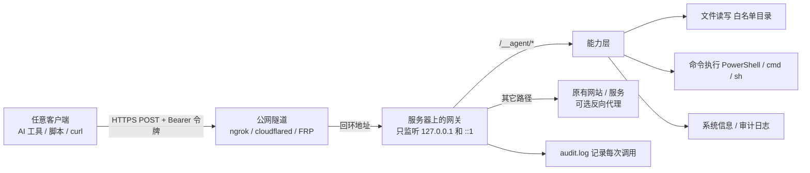

# 背景与架构

> 本页讲通用原理与选型理由。这套设计来自一台中国电信 TeleAgent 云电脑上的实际部署，机器约束、实测恢复时间与验证数据见仓库根目录 README 的「背景」一节。

## 核心概念

| 词 | 大白话 | 本文里的角色 |
|---|---|---|
| 远程服务器 / 云电脑 | 一台放在机房、你摸不到的电脑 | 真正干活、存文件的地方 |
| 网关（gateway） | 服务器上一个「前台」，只听本机的话，按请求办事 | 本方案要装的小程序 `gateway.js` |
| 隧道（tunnel） | 一根从公网牵到服务器「前台」的加密网线 | 解决「服务器没有公网 IP」 |
| 令牌（token） | 一把钥匙，一串随机字符 | 每次请求都要带上；**泄露 = 别人能控制你的服务器** |
| 客户端 | 你手上发号施令的东西 | AI 对话工具、脚本、命令行，随便哪个 |

一句话理解：**客户端 → 隧道 → 网关 → 服务器文件/命令**。客户端不直接碰服务器，网关替它做，且只做允许范围内的事。

---

## 为什么不能直接连接

### 服务器常见三种形态

| 形态 | 长什么样 | 能不能直接连 |
|---|---|---|
| **A. 标准云主机** | 有公网 IP、安全组，可开 SSH / RDP | 能。直接用原生远程桌面或 SSH，**不需要本方案** |
| **B. 厂商封装式云电脑** | 只给自家 App / 网页端；桌面是浏览器里的一次性链接；没有公网 IP、不开放对外 API、空闲自动关机、同时连接有上限 | 不能。自家客户端能用，第三方客户端进不来 —— **本方案主要解决这类** |
| **C. 企业版云桌面 / 智能体电脑** | 厂商提供官方 SDK / MCP / AccessKey 体系 | 能，且更合规。**优先用官方通道**，本方案作为补充 |

B 类的典型限制：桌面链接由服务端按登录态临时签发、只准 `http/https`、无固定 IP、无 RDP 端口、任务跑在云电脑内部、关机后会话断、网页端高峰期可能排队。这些限制决定了「GUI 自动化」很脆，**正确做法是加一层可控的 HTTP 控制面**。

### 四条路线对比

| 路线 | 优点 | 缺点 | 适合谁 |
|---|---|---|---|
| 远程桌面 / RDP / SSH 自动化 | 能操作完整桌面 | 需要公网端口；坐标点击不稳；很多封装式云电脑根本不给 | 有公网 IP 的标准云主机 |
| 厂商自家客户端下发任务 | 零搭建，本来就能跑命令 | 只能用那一家；异步、结果不结构化、空闲关机就断 | 临时一次性任务 |
| 厂商官方 SDK / MCP | 有文档、有凭据体系、合规 | 通常要企业版资源 | 企业 / 生产环境 |
| **自建薄网关 + 隧道（本方案）** | **客户端无关、确定性、可审计、可脚本化** | 要自己配一次；要自己保管令牌；遵守服务条款 | 想让任意客户端都能访问的人 |

### 本方案的取舍

不碰厂商客户端、不破解登录、不调用未公开内部接口。只在**你有管理权限的那台服务器**上放一个自己写的小网关，自己开一条隧道，自己保管钥匙。代价是：你要负责它的安全（见 [安全加固清单](07-operations.md#安全加固清单)）。

> **合规前提**：只在你自己拥有、或已获明确授权管理的服务器上使用；先确认厂商服务条款允许部署自建服务。未授权机器请勿使用。

### 本方案优势

| 维度 | 本方案 | 其它路线 |
|---|---|---|
| 客户端 | 一套 `POST /__agent/<动作>` + Bearer + JSON，脚本、命令行、支持自定义动作的 AI 客户端、支持 MCP 的客户端、纯对话客户端都能接 | 厂商自家客户端通常只能用那一家；SDK / MCP 常绑定企业版 |
| 稳定性 | 结构化 JSON 出入参，可重试、可脚本化、可断言 | GUI 自动化受分辨率、弹窗、排队、验证码影响；任务下发是异步且结果非结构化 |
| 对原服务的影响 | 网关只绑回环，非控制面请求原样反代原有服务并保留 `Host`，网站 / 业务不中断、不改端口、不改密码 | 改防火墙、开远程桌面端口或替换入口，容易影响原有服务 |
| 安全边界 | 不破解鉴权、不调用未公开接口；令牌、限流、路径白名单、命令策略、全量审计都在自己手里；出问题可随时停服务回退 | 依赖厂商内部接口，随版本变化且无文档，越权风险不可控 |
| 可移植性 | 网关零第三方依赖，目录白名单与 shell 用配置表达；换服务器只改配置，换客户端只改接入方式 | 换平台往往要重做整套自动化 |
| 成本 | 用已有隧道 + 已有服务器，不额外买企业版或新实例 | 官方 SDK 通常要企业版资源；GUI 方案常需额外常驻机器 |
| 可验证 | 从服务器本机自测 → 外部验收 → 16 项清单逐条打勾，每步都有明确期望结果 | 结果依赖界面状态，难做自动化验收 |

一句话：**用一层薄、可控、可审计的 HTTP 控制面，把「只有厂商客户端能进」的服务器，变成「任意客户端都能按规则访问」的服务器**，同时不牺牲原有服务和既有安全边界。代价与应对见 [能力与限制](06-capabilities.md)、[安全加固清单](07-operations.md#安全加固清单)。

---

## 整体架构

**三条铁律**（照做就不会把服务器暴露到公网）：

1. 网关**只绑回环地址**（`127.0.0.1` 和 `::1`），绝不绑 `0.0.0.0`。公网可达性完全交给隧道。
2. 每个控制请求先验令牌（定长比较），再限流，再检查路径 / 命令策略；未授权请求不占用限流配额。
3. 文件只能在**白名单目录**里读写；命令执行默认**关闭**，要用必须显式打开。

网关还可以把其它 HTTP 请求原样转发给服务器上已有的网站（`proxyPort`），这样加了控制面也不影响原来的业务站点。

---

## 准备清单

| 位置 | 需要什么 | 怎么确认 |
|---|---|---|
| 服务器 | 一台能登录、能放文件的 Windows 或 Linux 机器 | 能打开命令行 |
| 服务器 | Node.js 18+（或 Python 3.8+ 用于客户端） | `node -v` 有输出 |
| 服务器 | 管理员 / 有权限写目标目录的账号 | 能新建目录 |
| 服务器 | 一个想被访问的目录（例子里叫 `<数据目录>`） | 记下绝对路径 |
| 公网 | 一种隧道工具（ngrok / cloudflared / FRP 任选） | 能拿到一个 `https://...` 地址 |
| 本机 | 终端 + 文本编辑器 | 能跑 `curl` |
| 本机 | 一个能发 HTTPS 请求的客户端 | 见 [客户端接入](05-client-integration.md) |
| 双方 | 一份随机令牌（下一步生成） | 64 位十六进制字符串 |
